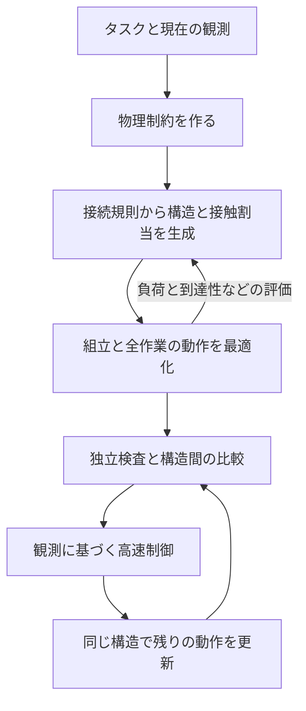

# A-MSRR 学習を使わない構造と動作の生成手法

設計版 v0.1。作成日 2026-10-16。**比較用の初案であり、現行の実装状況を表す文書ではない。** 現在の方式・拡張範囲・未解決点は[READMEの短い説明](../README.md)、試験の詳細は[作業記録](WORKLOG.md#現在地)を参照。

2026-10-18追記：Pro案に対する3回のレビューを経た[改訂案v0.2](THEORY_AND_METHOD_v0_2_ja.md)と[レビュー記録](WORKLOG.md#2026-10-18-pro案の反復レビューと改訂版の保存)を追加した。本書の手法本文は比較用の初案として保持している。改訂案も実装候補であり、VIM4での速度と実機完遂は未検証である。

採る手法は、**タスクを物理制約へ変換し、接続構造の探索と、その構造で実行できる動作の最適化を往復させる方式**とする。構造は接続規則からその都度生成する。構造の評価には接近から終了・退避までの動作を含め、実行時は観測に基づいて動作を更新する。学習器は使わない。

最優先の成果は「タスクAに対して、構造Bと動作Cを選んだ理由」を、制約、計算した動作、比較した代案で説明できることである。以下のアルゴリズムと数値予算は今回の設計判断であり、先行論文や本家の実績から性能保証を引き継ぐものではない。

## 1 合意した条件

| 項目 | 本計画の条件 |
| --- | --- |
| 目的 | 多様なタスクに対して適した構造を作り、組立から作業実行まで自律で行う |
| 機体 | 本家と同じHolon、接続口、関節、推力、接触面、物理上限 |
| タスク入力 | 現行と同じ構造化入力。基本的な作業手順はタスク種別ごとに与える |
| 学習 | 一切使わない。学習済み認識・方策・代理評価を新たに追加しない |
| 探索 | 乱数利用可。初期値・候補順・計算予算を記録する |
| 保存 | 共通計算の保存と初期値用の構造は可。大量の既製構造から選ぶ方式は禁止 |
| 計算場所 | VIM4。必要かつ実測で有効なら複数台に分散できる |
| 時間 | 飛行を継続しながら初期計画を数秒〜十数秒。制御は高周期で継続 |
| 観測 | 現行の姿勢・物体状態・モータ情報等。接触力の直接計測を仮定しない |
| 構造変更 | 最初は作業途中の分離・再結合を扱わない。作業前の組立は含む |
| 評価 | 理論的な説明を第一に、台数、入力負担、時間、組立、誤差への強さを評価 |

対象タスクは自由飛行、把持・搬送、バルブ操作、環境への支持・固定を利用した作業、接触を利用した移動。最初の実装で全種を同時に完成させるのではなく、同じ物理モデルと計画器に接続する。

この文書は本家の学習器を単純に固定の採点関数へ置換する仕様ではない。構造を先に確定してから動作だけを救済する責務分担も引き継がない。低レベルの制御についても、後述する全身の力学に基づく指令生成を新しい設計として提案する。

## 2 入力と生成する結果

入力はタスク目標、許容誤差、制限時間、基本手順、物体・環境形状、物理特性の推定値、利用できるモジュール、各モジュールの現在状態である。飛行中の機体を初期姿勢へ瞬間移動させず、計画受理時の観測から組立を始める。

出力は以下の四つを一組にする。

1. 接続構造：使用モジュール、接続口の組、接続関係、作業に使う未占有の接触面。
2. 組立計画：どの順序で接近・位置合わせ・結合・確認を行うかと、その運動。
3. 作業計画：接触対象・接触位置、機体と物体の運動、関節角、推力、関節負荷、時間配分。
4. 根拠記録：満たした制約、余裕、比較候補、未探索範囲、計画の有効な観測範囲と期限。

組立順序だけ、静止した把持姿勢だけ、または軌道だけを得た状態は、全体の成功とはしない。



## 3 機体と観測の固定範囲

物理入力の正本は、このリポジトリへコピーした [機体設定](../configs/robot/robot_model.yaml)、[推力設定](../configs/robot/thrust_model.yaml)、[関節設定](../configs/robot/joint_actuators.yaml)、[URDF](../assets/robots/holon/holon.urdf) とする。由来は [コピー台帳](../references/mainline_snapshot.json)。URDFは部品と関節を記述するモデルである。

- 1モジュールには4ローター、4つの推力方向変更関節、4つのDock関節がある。Dockはモジュール同士の結合機構である。推力設定は各ローター最大20 N。
- 接続はpitch側とyaw側の組で行う。同じ種類同士を接続しない。組立用の接続座標と、物体に触れる面の座標を区別する。
- 可動域、連続負荷、ピーク負荷、速度、実行設定の制限を区別する。例えばDockの連続定格1.3 Nmを、ピーク4.1 Nmへ無断で置換しない。
- 初期の探索対象は現行v1と同じ、輪を作らない接続構造とする。既定は最大8モジュールだが、各タスクが指定した台数上限を使う。
- 寸法、質量、モータ仕様を設計変数にしない。変更できるのは組合せと使用方法である。
- 観測の出所と時刻を持つ。モータ負荷から各接触点の正確な力・モーメントを一意に求められるとは仮定しない。

本家の暫定計画器には、タスクの安全距離と異なる小さい衝突余裕を使った履歴がある。本計画はTaskSpecの指定値を使い、数値計算用の許容誤差と物理的な安全余裕を分ける。3 cmの要求を、1 mmで接触しなかった結果で満たしたことにしない。構造上必要な結合面と意図した作業接触のみ、明示された部位対・段階で例外にする。

コピーした衝突除外表は由来確認用でもある。除外する部位対が、現在の構造と全可動域で許される接触かを確認してから使う。過去の姿勢だけで決めた除外を自動採用しない。

## 4 数学的な問題

### 4.1 何を同時に決めるか

タスク・環境・初期観測をA、接続構造をG、組立順序をa、接触の割当をb、動作全体をzと書く。

$$
\min_{G,a,b,z}\;J_A(G,a,b,z)
\quad\mathrm{subject\ to}\quad (G,a,b,z)\in\mathcal F(A).
$$

Gは離散変数、すなわち接続する・しない等の選択である。zは連続変数で、機体・物体の位置と姿勢、速度、関節角、ローター角、推力、関節トルク、接触力、接触位置、区間時間を含む。接触の切替順序は基本手順に従い、各段階でどの面を使うかと切替時刻を決める。

作業中はGを固定する。作業前の組立ではaに従って接続が増えるので、各中間構造と結合前後の状態も検査する。

構造Gの評価は、その構造で得られる動作に依存する。

$$
V_A(G)=\inf_{a,b,z:\,(G,a,b,z)\in\mathcal F(A)}J_A(G,a,b,z).
$$

実装が計算するのは限られた時間で得た成立解の評価値であり、真のVを計算できたとは扱わない。最適化で未発見だったGを、Vが無限大の構造と断定しない。

### 4.2 評価基準

目標達成、物理上限、安全距離、観測・追従誤差を見込んだ必要な余裕は必須条件にする。費用と引き換えに違反を許す報酬設計は使わない。

成立した計画の比較には、初期案として次の優先順を使う。この順序はユーザーが個別指定した優先順位ではなく、比較を再現可能にするための設計上の既定値である。

1. 使用モジュール数を少なくする。
2. 動作全体で最も厳しい、上限に対する推力・関節負荷・速度の使用率を下げる。
3. 組立開始から作業・退避までの時間を短くする。
4. 上限で正規化した推力・トルクの二乗積分を小さくする。

上位の評価が同程度のときに下位を比較する辞書式の順序を使い、比較許容幅は計算精度と一緒に設定へ固定する。既定の台数優先が適切でないタスクでは、入力側で優先順を変更する。結果を見て特定条件だけ変更しない。

第4項はアクチュエータの入力負担の指標であって、電力量ではない。効率・電流のモデルが確認できるまではJやWhで報告しない。輪のないN台の構造は結合数がN−1なので、同じ台数の構造間で結合数だけを組立容易性の差として数えない。組立時間と経路の余裕を使う。

### 4.3 タスクから制約を作る

| タスク | 入力から導く物理要求 | 自動で決める主な変数 |
| --- | --- | --- |
| 自由飛行 | 目標姿勢、経路の空間、必要加速度、推力余裕 | 構造、姿勢、関節、推力、時間 |
| 把持・搬送 | 物体の重力・運動に必要な力、滑り防止、配置条件 | 接触面の割当、接触位置、支持荷重、全身運動 |
| バルブ | 指定軸まわりの必要トルク、回転角、反力 | 接触位置と力、反力を支える姿勢と構造 |
| 支持・固定 | 環境へ渡す荷重、機体保持、許可された固定方法 | 支持面、接触点、推力との荷重配分 |
| 接触移動 | 支持を保った重心移動、接触の受渡し、推力割合 | 支持先の割当と切替、身体・自由な接触部の軌道 |

タスク別に変えるのは目標と、接触を開始・維持・終了する条件である。構造を選ぶソルバーや成否に合わせた採点式を別々に作らない。未確認の吸着能力・引張り接触・固定機構は追加せず、機体と環境に実在する能力だけを使う。

## 5 計画と制御で共通に使う物理モデル

### 5.1 全身と物体の力学

qを機体の浮遊する基部と全関節の姿勢、vを速度とする。固定した構造Gについて、同じ関節を持つ剛体モデルから次を計算する。

$$
M_G(q)\dot v+h_G(q,v)
=S_d^T\tau_d+S_g^T\tau_g+B_G(q)f+J_G(q)^T\lambda.
$$

Mは質量・慣性、hは重力と運動に伴う力、τdはDock関節のトルク、τgは推力方向変更関節のトルク、fはローター推力である。λは物体・環境から機体へ作用する接触力。Sは対応する関節への写像、Bは実際のローター位置・方向への写像、Jは接触点と全身運動の関係を表す。

物体には反対向きの力が作用する。物体の並進・回転も同時に解き、機体の釣合いだけを満たした力配分を採用しない。バルブは物体側の回転関節と抵抗トルクを持つモデルにする。

Dock関節の重力・推力反力・慣性負荷を含める。初期実装は低速動作から検証するが、速度を遅くしたことだけを理由に関節負荷を省かない。機体を単一剛体に近似した釣合いは候補の予備評価に限る。

運動の変数にする関節はDockと推力方向変更の各4軸である。URDFにあるローター自転用の関節を、追加の姿勢制御軸として数えない。ローター部品の質量・慣性は保持し、空力作用は現行の推力・反トルク設定から与える。自転の詳細モデルを省くことによる誤差は、現行モデルの適用範囲として扱う。

### 5.2 接触と接触位置

物体・環境の接触可能な表面を、平面、円柱面、球面、またはメッシュの局所面として表す。領域は探索範囲であり、中心を最終接触位置に固定しない。実機側も有限な接触面を持ち、接触位置をその面内に制限する。

各接触は、機体側の面と対象側の面、面内座標、接触モードを持つ。接触モードは非接触、取得、保持、荷重を抜く、解放を基本とする。支持・押し等の意味は許される力と相対運動の制約で表す。

- 非接触では接触力を0にし、実形状間の距離を保つ。
- 保持では接触位置、面の向き、相対運動、片側にしか押せない条件、摩擦を整合させる。
- 取得・解放では、接触前後の相対速度と力の変化を制限する。最初は衝撃を利用する動作を扱わない。
- 接触力は法線成分が非負で、接線成分が摩擦の範囲に収まる。引張りができる固定機構は、実在し検証された場合にだけ別モードにする。
- 初期モデルは接触点の3次元力を基本とし、未確認の接触面内のねじり抵抗を無料のモーメントとして使わない。面の能力が確認された場合は、その力・モーメント範囲を物理入力として追加する。

$$
\lambda_n\ge0,\qquad \|\lambda_t\|_2\le\mu_{\rm conservative}\lambda_n.
$$

摩擦の多角形近似を使う場合、**成立解の計算には内側の近似、不可能性を検討する緩和問題には外側の近似**を使う。両者を逆にしない。

硬い接触の理想モデルは、形状と接触状態の計画に使う。実際の変形・モータ追従によるずれは、接触面とアクチュエータのモデル誤差として検証する。静的な接触力の解が、そのまま実測された力になるとはみなさない。

### 5.3 モータで実現できる指令

推力方向は計画した未来のローター角と、現在測定した角度を区別する。高速制御で利用できる力の方向は現在の実測角から決める。未来の角度へ瞬時に回転できるという自由度を与えない。

Dockは実機が受け取れる位置・速度参照とトルク補助指令を使う。計画したトルクを実現する際は、関節内の位置・速度制御が加えるトルクも含める。

$$
\tau_{\rm applied}
=\operatorname{limit}\{\tau_{\rm bias}
 +K_p(q_{\rm ref}-q)+K_d(\dot q_{\rm ref}-\dot q)\}.
$$

計画・制御の受理条件は、この合成指令の負荷・速度・通信範囲である。τbiasだけの制限で済ませない。実際のモータ設定でこの意味が一致するかを最初の検証に置く。

推力方向変更関節は位置・電流制限のインターフェースを維持する。高速制御に独立した自由トルク変数を追加せず、実測状態・モータ情報とサーボモデルから、その周期のトルクと誤差範囲を与える。参照角の変更は速度・負荷を検査した計画更新が担当する。実現可能なサーボモデルが未確認なら、この部分の制御成立を未検証とする。

### 5.4 誤差を扱う範囲

観測位置・姿勢の誤差、通信による情報の古さ、実指令の追従誤差、摩擦・質量等の推定誤差を、別々の入力として持つ。値は既存の仕様かD0の測定から定める。資料に誤差幅がないものを、ゼロと仮定して頑健性を主張しない。

例えば制約をg(x)≤0としたとき、状態誤差の上界εと、その範囲で有効な変化率上界L、残るモデル誤差の上界δが得られるなら、計画にg(x̄)+Lε+δ≤0を課す。幾何のLは関節の変位から接触面・衝突部品が動く範囲に基づいて求める。情報の古さによる変位も速度上界と経過時間から加える。

これは有効な上界がある制約での条件付き保証である。上界の代わりに実測した誤差範囲を使う場合は、根拠記録へ `tested_error_envelope` と記録し、数学的保証と区別する。誤差を持つ接触・サーボについて、同じ固定指令が全条件で成立すると仮定せず、観測による制御の修正を含めた範囲を検証する。

入力誤差の範囲を超えた場合は計画の有効性を失う。誤差に対応するためにタスクの位置許容値・機体負荷上限を拡大しない。

## 6 構造と接触の探索

### 6.1 大量の構造集を持たずに生成する

単体モジュールを出発点とし、物理的に適合する空き接続口へモジュールを追加する。再探索には葉の削除、木を一辺で切って別の適合口へつなぎ直す操作、接続口の変更を使う。部品の追加・接続は計算上の候補生成であり、飛行中に未受理の組立を実行する意味ではない。

構造を形や名前の分類へ当てはめない。同じ構造をモジュール番号だけ変えて再計算しないよう、接続口の種類、関節の向き、接触面を保った同型性で重複を除く。物理的に同じと確認できない左右反転や関節軸の反転は同一視しない。

鎖や枝分かれ等の少数の初期構造を使う場合も、入力した接続規則から作る初期値に限る。その構造の近傍だけで探索を終えることを必須にせず、単体からの追加生成にも計算枠を残す。

輪のない有限構造は葉を順に除いて単体へ戻せるので、逆の適合口への葉追加を全て列挙すれば、この探索空間の構造を表現できる。ただし時間制限付き実装は全列挙しない。これは**表現範囲の説明**であって、期限内の探索完全性や動作最適化の完全性の保証ではない。

### 6.2 タスクから探索を絞る

各候補に対し、次の順に計算する。

1. 台数、接続口占有、接続適合性、必要な接触面の数を調べる。
2. 自由飛行に必要な総推力、最大到達距離の上限、物体の必要な合力・モーメントを使った安価な必要条件を調べる。
3. 少数の代表状態で、全身姿勢・接触位置・力配分をまとめて解く。
4. 代表状態を結ぶ全動作と組立を解き、独立検査する。

第2段階は、本来の成立集合を含む広い集合で調べる「緩和」として定義する。例えば、実際には関節で制限される推力方向を自由にした条件でも力が足りなければ、その完成構造では不足する。成立しても元の構造の成立を保証しない。

例として、環境からの支持を使わず、N台で物体の重さを支える区間では、機体の姿勢と推力方向を無視した楽観的な必要条件が次になる。

$$
4N f_{\max}\ge(1+r)(Nm_{\rm module}+m_{\rm object})g.
$$

rはタスクが要求する推力余裕の比率である。各モジュールが4ローターを持つことと、機体・物体全体の力の釣合いから導く。これから台数の下限を計算できるが、関節負荷、反力モーメント、傾いた推力方向を省いているので十分条件ではない。推定値に幅があるときの不可能性判定には、最も軽い質量・最も有利な推力を使っても不足することが必要である。環境支持を許す区間へこの式を無条件に適用しない。

関節姿勢一つで届かない、局所最適化が失敗した、外接箱が重なる、という理由だけでは構造全体を不可能として除外しない。外接箱は離れていることの安価な確認に使い、重なった場合は詳細形状へ進む。

まだモジュールを追加できる途中の構造には、完成構造用の推力・到達性棄却を適用しない。残り台数を最も有利に使った上限でも不足する場合だけ、その子孫を棄却できる。

### 6.3 接触の割当

タスクの接触枠と、構造の未占有の接触面を対応付ける。接触数はタスクの指定範囲から選ぶ。物体や環境側は表面領域を選び、具体的な位置は連続最適化へ渡す。

割当はその場で少しずつ生成する。摩擦・法線方向・到達範囲等で順序を付けるが、単純な距離の点数だけで成立とみなさない。保持中の接触部の変更は、基本手順が許す接触の受渡しでのみ行う。

乱数は初期姿勢・接触位置・探索順の分散に利用できる。タスクから計算した制約と同じ評価を使い、成功したケースIDの表や結果を予測する学習済み関数は置かない。

### 6.4 探索の進め方

探索待ちの候補を、必須条件、台数の下限、動作計算の進捗、同じ評価関数の値で優先付けする。評価値が未確定の候補も捨てず、予算不足として区別する。初期プロファイルでは、既知の成立候補の改善に最大75%、別構造の生成に最低25%の探索時間を配分する。これは性能を測るための固定した初期設定で、理論定数ではない。

```text
観測を固定し、タスクと現在状態から制約を作る
期限内に飛行を続けられる制御と回復区間を確認する
探索待ちへ単体からの生成入口と少数の初期構造を入れる
成立済みの最良計画 = なし
計算・検証の残り時間がある間:
    候補構造を取り出し、必要条件を検査する
    証明できた矛盾だけを棄却し、証拠を保存する
    接触割当と代表姿勢を計算する
    有望なら組立と全作業動作を計算する
    独立検査に通った計画だけで最良計画を更新する
    計算結果を使って次の構造・接触候補を生成する
期限で終了し、現在観測と照合した成立計画または未発見を返す
```

関節負荷が大きい枝などは次に変更を試す場所の順位付けに使える。ただし「重い物体ならこの形」という例外規則は作らず、変更後も同じ物理計算で評価する。局所最適化の乗数を使う感度解析は、その姿勢・接触条件近傍だけの説明として記録する。

## 7 連続する動作の計算

### 7.1 代表状態から全軌道へ

構造・接触割当を一つ固定すると、連続変数だけの問題になる。最初は接触取得、荷重移行、作業の終端、解放といった代表状態をまとめて解く。把持姿勢だけを先に確定して、最後に配置・退避を追加する順序にはしない。

この結果を初期値として、全身・物体の軌道を少数の時刻へ離散化する。初期設定は作業全体で12〜24節点、必要箇所を追加して最大48節点。組立は別の区間列を持つが、同じ物理計算と全体予算を使う。節点数を減らしたモデルは初期化・予備評価用であり、独立検査を省く根拠にはしない。

区間時間も変数にして、速度・加速度・関節負荷・推力方向変更の速度を満たすように決める。空間経路が同じでも、時間だけを変更した後は力学・モータ負荷・期限を再計算する。

### 7.2 解法

順次二次計画法を採る。これは、現在の姿勢・動作の近くで制約を近似した小さな二次最適化問題を解き、元の非線形制約で確かめながら更新する方法である。接触の割当・モードは一回の計算中に固定する。

- C++で、関節運動・力学・形状距離の微分を計算する。全変数を一つずつ動かす数値微分を高周期の標準経路にしない。
- 更新幅を制限し、元の制約違反と目的値を再計算する。近似問題が解けただけでは受理しない。
- 制約を満たす解を見つける段階と、成立解の費用を改善する段階を分ける。前者で使う違反量の補助変数は、最終解の物理制約を緩める許可ではない。
- 軌道の力学は中間点を含む離散化で解き、別の積分・残差評価で確認する。静的釣合いだけの結果を動的な合格にしない。
- 狭い経路の初期値が得られない場合は、同じ予算内の配置空間のサンプリング探索を初期化に使える。最終的な速度・力学・接触制約は同じ計算で満たす。

二次最適化の初期候補はOSQP、関節を持つ機体の力学と微分の初期候補はPinocchioとする。ともに学習器ではない。採用版、ARM64ビルド、計算時間は実装時に固定・確認する。ライブラリの選定をA-MSRRでの性能実証とは扱わない。

### 7.3 独立検査

生成した計画を変更せず、別の計算経路で目標、接触、力学、モータ上限、衝突、時刻を再評価する。検査が解を補正して実行器へ渡すことはしない。修正は新しい計画として再検査する。

関節位置は連続補間、姿勢は回転として整合する補間を使い、実行器も同じ補間を評価する。速度・加速度はその曲線から求める。

区間衝突は、形状間距離と区間内の相対移動速度の上界を使う。例えば長さhの区間に対し、有効な速度上界Lが得られれば、端点の最小距離からLh/2を引いた値で区間を保守的に検査できる。上界が証明できない区間は分割・詳細検査し、予算内に確認できなければ未検証とする。有限個の時刻だけを確認した結果は、連続時間の保証とは呼ばない。

検査には形状・物理モデル・観測・コード・設定の識別情報を結び付ける。古い観測に対する解は、現在観測が許可範囲内にある場合にだけ採用する。

## 8 組立の扱い

目標構造が作業可能でも、飛行中に組み立てられなければ採用しない。木構造の葉から取り外す逆順を組立順序の候補として作り、部分構造の飛行成立性、接続口への接近、結合時の相対姿勢・速度・荷重、結合後の制御引継ぎを検査する。途中の構造が飛べなければ別の順序または別の完成構造を試す。

組立の全経路を確認した候補だけを完全な解とする。順序だけ確認した状態は `assembly_order_only` とし、全体成功へ含めない。

結合後は接続確認と状態推定を行い、新しい質量・慣性・座標系へ制御を引き継ぐ。物体を掴むことと、機械的にラッチで結合することを区別する。物体把持をシミュレータの固定ジョイントで代用しない。

最初の局所検証では組立済み機体から作業制御を検証してよいが、最終の自律構造構築の評価には、実際の初期配置からの組立を含める。

## 9 実行時の制御と再計画

### 9.1 全身の力学から指令を作る

高速制御の第一案は、全身の逆動力学を使う二次最適化とする。逆動力学とは、望む運動に必要な推力・関節トルクを力学から求める処理である。

現在の実測姿勢と接触推定を固定し、全身加速度、Dockトルク、ローター推力、モデル上の接触力を計算する。機体・物体・関節の追従誤差を減らし、力学、接触モード、摩擦、実際の推力方向、合成モータ指令の上限を同時に課す。接触力は予測用の内部変数で、測定入力でも、直接操作できる指令でもない。

推力方向変更関節の参照は受理済みの軌道から供給し、高速計算は現在の実測方向で配分する。目的の運動が今の推力方向で実現できなければ、追従目標側を制限し、角度変更を含む次の計画更新へ戻す。物理制約を緩めて追従を優先しない。

Dockへのトルク補助指令と位置・速度参照は5.3の合成則で実機へ写像する。追従の柔らかさを持たせる関節制御を併用し、取得時の誤差から過大な接触力を発生させない。剛性・減衰はモータ・接触の共通モデルから定め、物体IDごとの調整表を作らない。

これは、本家の「全体の飛行制御とDock位置制御を分離する」方式からの設計変更である。機体上限・センサ・モータ機能は変更しない。この写像が成立するかを大規模な構造探索より先に検証する。成立しなければ、独立した制御方式の再設計が必要であり、本家の成功数で代替しない。

### 9.2 接触の取得と段階の切替

実行器は、観測された接触部と対象の相対位置・速度、モータ負荷、物体運動、制御余裕、観測の有効性を使う。予定時刻や計画した接触力だけでは段階を進めない。

取得では小さい相対速度で近づき、面間距離と負荷の応答が整合することを確認してから荷重を移す。滑り・接触不足・推定無効を検出したら、支持を保てる範囲で負担を減らし、動作更新または宣言済み回復へ進む。個別接触の正確な力を再構成できたとの前提は置かない。

支持先の切替では、新しい支持が観測上成立する前に古い支持を解放しない。解放では、物体・機体の荷重が次の支持へ渡ったことを観測で確認する。条件を観測から識別できない場合は、その遷移の自律実行を合格にしない。

### 9.3 動作の更新

構造Gは固定したまま、最新観測から短い将来区間の接触位置、姿勢、力配分、時刻を再計算する。前の解を初期値に使う。保持中の接触点を無断で別の面へ飛ばさず、滑りの補正と、意図的な接触の付替えを区別する。

計算を一度に収束まで回す方式ではなく、一周期に最大2回の順次二次計画更新を行う初期案とする。更新前後とも現在状態からの実行可能性を検査し、目的値だけ改善した不成立解は使わない。

短い区間だけ最適化して配置・解放を不可能にしないよう、残りの粗い全作業計画を維持する。新しい区間は、引継ぎ時刻の位置・速度と、後続へ接続できる終端条件を持つ。終端条件には、観測誤差の範囲内で荷重を保てる保持状態または検証済み回復へ進める状態を含める。

### 9.4 遅延と失敗

計画処理が停止・遅延しても制御処理は待たない。現在状態が受理済み計画の有効範囲内なら、その区間と回復計画を使う。範囲外なら物体を安全に支持・配置する等、事前検証した回復へ進む。最後の指令を保持するだけで安全とはしない。

初期探索の開始前にも、現在の分離モジュール・部分構造が、探索期限と回復に必要な時間だけ飛行を続けられることを確認する。電力余裕や障害物条件が足りなければ、空中で探索を開始しない。

連続時間の安全保証や、毎回の再計画で必ず成立解が残る保証は、誤差範囲・終端条件・制御成立の証明が揃った範囲に限る。これらを未検証のまま「再計画する制御だから安定」と説明しない。

## 10 VIM4での時間設計

以下は**初期実装の予算と合否目標であり、実測性能ではない**。OSの実行待ち、観測受信、計算、検査、指令送信を含めて測る。新しい構造のモデル準備も初期計画時間に含める。

| 処理 | 初期目標 | 計算範囲 |
| --- | --- | --- |
| 全身制御と指令出力 | 200 Hz、周期5 ms | 1回の二次最適化と物理・指令検査。通常計算予算3 ms、残りは受信・送信・余裕 |
| 状態・段階監視 | 制御周期で更新 | 新しい観測の有無と時刻を確認。低速センサを200 Hzで得たことにはしない |
| 動作の再計画 | 20 Hz、期限50 ms | 約0.5秒・10区間を初期値に最大2回更新。計算30 ms、検査・送受信等20 ms |
| 構造を含む初期計画 | 目標5〜10秒、上限15秒 | 組立・全作業・検証・初期モデル準備を含む |

初期計画の15秒は、入力と安全継続確認0.5秒、構造・接触・代表状態探索6.5秒、全軌道と組立の詳細化・独立検査5秒、最終観測照合と根拠保存1秒、余裕2秒を初期配分とする。途中で成立解を得たら返せる。未完了候補に予算を使い切って検査時間を残さない設計は禁止。

制御用の実行資源を確保し、探索は低い優先度の最大2ワーカーから開始する。ワーカーは計算処理でありAIエージェントではない。高速経路はC++、固定サイズの作業領域、共有状態の短い受渡しとする。Python、動的なメッシュ変換、ライブラリの初回コンパイルを制御周期に入れない。

二次問題の行列の疎な配置は再利用できるが、状態に依存する数値因子分解を古いまま流用しない。数値行列が同一な場合だけ再利用する。制約の組が変わったときは再構築時間を測定する。

本家にはVIM4で姿勢計算を高速化した記録があるが、衝突、接触、全身制御を全て含む200 Hzの根拠ではない。最悪観測時間、99百分位、期限超過、熱による速度変化、同時探索の干渉を測定する。最大観測時間を、数学的な最悪時間保証とも区別する。

分散を使う場合は候補構造の評価を独立に配る。時刻付き観測とモデル識別情報を共有し、遅れた結果は採用前に再検査する。高速制御を通信待ちの合意処理に依存させない。まず1台で成立範囲を測り、同じ総期限で得られる成立解と通信負担を比較してから採用する。

## 11 理論的に説明することと説明しないこと

### 11.1 出力に付ける根拠

| 根拠 | 記録する内容 |
| --- | --- |
| タスクとの対応 | 各制約を、どの目標・作業段階・物理条件から導いたか |
| 構造の妥当性 | 接続口、関節の向き、接触面、組立と部分構造の飛行成立性 |
| 動作の成立 | 独立再計算した力学・接触・摩擦・負荷・衝突・期限の最小余裕 |
| 実現可能性 | 計画上の力を、どの実機入力に写像したか。その誤差と検証範囲 |
| 選択理由 | 比較した構造・動作の費用、制約違反、時間切れを区別した一覧 |
| 限界 | 未探索の構造、未検証区間、モデル誤差、観測の有効範囲 |

例えば「バルブの抵抗が増え、同じ姿勢ではDock負荷を超える。そのため、作用点間隔と反力の支え方を変える構造・動作が選ばれた」という説明は、同じ力学式による負荷比較を伴って出力する。名称だけで“トルク用構造”と呼ぶ説明にはしない。

最適化の乗数は、小さい条件変化に対してどの制約が費用を押し上げるかの局所的な説明に使える。構造全体の優劣や、不可能性の証明には使わない。

### 11.2 保証の区別

- **探索空間**：木構造の生成規則で表現できる範囲を説明できる。期限内に全構造を試したとは言わない。
- **棄却**：元問題を含む緩和でも不成立と証明した場合だけ、該当範囲を不可能と扱う。数値証明の残差・許容誤差を記録する。
- **成立**：保存解を独立検査した、明示したモデル・離散化・誤差範囲での成立である。物理実行成功は別に検証する。
- **最適性**：成立解の費用は最良費用の上界になる。非凸の局所最適化値は下界にはならない。全未探索候補を含む有効な下界がない限り、大域最適性の差を報告しない。
- **実行**：支持の保持、追従、再計画の遅延処理を実経路で確認する。理想的な接触力を置いた数式だけでは実行保証にならない。

理論的根拠の第一段階は、全世界で最適な構造の証明ではなく、**同じタスクから一貫した物理問題を作り、構造と動作をその解として生成し、主張の範囲を確認可能にすること**である。

## 12 成果物の契約

実装前の論理的な出力項目を次のように定める。既存の本家schemaを変更する作業ではない。

| 項目 | 内容 |
| --- | --- |
| task_snapshot | 目標、形状、物理設定、観測時刻、観測の有効性 |
| design | モジュール、接続、使用面、現在構造からの組立順序 |
| plan | 状態・入力・接触の全軌道、補間、時刻、引継ぎと回復条件 |
| validation | 独立検査結果、最小余裕、検査種別、未検証事項 |
| search_record | 初期値、乱数設定、生成候補、棄却根拠、予算、探索時間 |
| selection_reason | 評価順序と値、比較候補、優劣の根拠と不明な範囲 |
| runtime_record | 観測、要求・制限後・適用指令、段階、遅延、接触推定、実結果 |

探索状態は `validated_solution`、`proven_infeasible_within_model`、`no_solution_within_budget`、`invalid_input` を分ける。個別候補には局所最適化失敗、組立のみ未検証、区間検証未完了等を残す。実行状態も完了、回復、失敗、中断を区別する。

## 13 検証する順序

本家の①〜⑤と区別し、本計画はD0〜D4を使う。途中段階の成功を全体の完成に読み替えない。

| 段階 | 最小の成果と検査 | 次へ進む条件 |
| --- | --- | --- |
| D0 物理と指令 | 2台の既知姿勢で自由飛行、1接触の負荷、Dock指令の実適用を比較。8台で力学・制御の計算負荷も測る | 独立力学計算と実指令が整合し、VIM4で制御単独の5 ms周期試験を通る |
| D1 構造と代表姿勢 | 最大3台の小問題で接続構造を開発時に列挙して参照結果を作る。オンライン生成と比較し、棄却規則・重複除去・選択理由を点検 | 既知の成立構造を誤棄却せず、生成結果の制約と比較根拠が一致 |
| D2 全作業 | 把持・配置、支持先の一回切替、バルブ回転を同じ計算経路で実行。各タスクで物理量を一つだけ変える比較を含む | 構造・動作が入力制約に応じて変わり、変更せずに足りる場合も説明できる。計画から実行まで成功 |
| D3 再計画と時間 | 物体位置・荷重推定・追従誤差、計画遅延・欠落を試す。VIM4で制御と探索を同時実行 | 初期15秒、制御・更新期限、宣言した誤差範囲、回復条件を満たす |
| D4 自律組立から実行 | 飛行中の分離モジュールから、組立・確認・作業・終了をつなぐ。異なる場面にも同じ規則を適用 | 途中の人間の構造選択・軌道修正・初期状態への戻しなしで全工程を完了 |

D1の全列挙は、小問題の検証用である。結果を大量の構造候補集として実行時へ輸出しない。動作の局所解しか得られていない構造については、全列挙でも真の最良動作を知ったことにはしない。

D2の初期比較は、把持の物体寸法と質量、バルブの必要トルク、支持先の間隔をそれぞれ独立に変える。評価条件は計算前に固定し、成功例だけを残さない。構造が変わること自体は合格条件ではない。同じ構造で動作を変えることが合理的なら、それを正しい結果とする。

同じ期限で、固定した初期構造だけを使う対照、構造生成あり、代表姿勢だけで選ぶ対照、全動作まで評価する方式を比較する。比較のための対照を実行方式の例外分岐に残さない。

物理実行では計算刻みを段階的に細かくし、成否だけでなく接触・荷重・衝突の値が収束するかを点検する。シミュレータの接触力はこの監査に使えるが、実行器へ入力しない。

全体評価の成功率と許容失敗率は、実装前に評価パネルとともに固定する。現段階で未測定の成功率や、全タスクでの15秒以内を約束しない。

## 14 実装の分け方と再利用

新しい実行経路は、タスク制約生成、構造生成、動作最適化、独立検査、実行器の五つを中心とする。高速制御は実行器の下位に置く。探索の試作ごとに別runnerや別の安全判定を増やさない。

本家から再利用する候補は、URDF読込、接続座標、順運動学、実形状の衝突検査、物理設定、シミュレータへのアクチュエータ写像である。コピー後に独立検査する。学習器、候補採点モデル、学習データ、教師の答えに依存する初期値、ケース別の救済処理は持ち込まない。

本家の制御器は比較用には使えるが、9.1の新しい全身制御が実装・検証済みであることの代用にはしない。推力配分だけを取り込む場合も、許可される力の集合と最終適用指令を一致させる。

保存できるものは、モジュールの不変幾何、衝突用形状、解析計算の構造、同じ入力に対する計算結果である。観測・物理モデル・制約が変わった場合は、保存解を初期値に使えても成立判定は再計算する。

今回コピーしたのは機体入力と資料のみ。ソルバー、制御器、シミュレータ接続、学習器はまだコピー・実装していない。

## 15 初期案で採らない方法

| 方法 | 初期案で採らない理由 |
| --- | --- |
| 大量の構造・動作ライブラリから選択 | タスクから構造を生成する要件を満たさない |
| 全構造と全接触を一つの巨大な整数・接触最適化で解く | 問題の定義には使えても、数秒の初期実行手段としての計算根拠がない |
| 接触の有無を全時刻で自由にした最適化 | 基本手順を入力できる利点を捨て、初期実装の非線形性を増やす |
| 静止した姿勢だけで構造を確定 | 接近・荷重移行・解放ができない構造を選び得る |
| 計画力を決めた後に位置制御へ無検証で変換 | 計画と実際の指令の関係を説明できない |

## 16 先行研究との関係

以下は考え方・計算要素の根拠であり、この機体での性能の根拠ではない。文献から転用する部分と本計画の設計判断を区別する。

- [Spielbergら Functional Co-Optimization of Articulated Robots](https://arxiv.org/abs/1707.06617)：設計変数と動作・入力・接触力を同じ最適化で扱う先例。本計画では物理部品を変えず、離散的な接続構造を外側で探索する。論文の計算時間や形状変更をそのまま採用しない。
- [Toussaint Logic-Geometric Programming](https://www.ijcai.org/Proceedings/15/Papers/274.pdf)：離散的な選択で連続問題の制約を定め、代表状態から全経路へ詳しく計算する考え方。本計画では組立構造と機体・物体の力学、実アクチュエータ制約を含める。これだけでは高速性・完全性を保証しない。
- [Herzogら Momentum Control with Hierarchical Inverse Dynamics](https://arxiv.org/abs/1410.7284)：全身の力学と制約からトルクを求める制御の実機検証例。本計画の推力方向可変機体と位置制御型モータへの写像は別に検証する。
- [Diehlら Real-Time Iterations for Nonlinear Optimal Feedback Control](https://skoge.folk.ntnu.no/prost/proceedings/cdc-ecc05/pdffiles/papers/1186.pdf)：前の解を引き継ぎ、一周期の更新を限定する参考。収束・安定の条件を満たした範囲の結果であり、任意の接触切替に自動適用しない。
- [Stellatoら OSQP](https://web.stanford.edu/~boyd/papers/osqp.html) と [公式の計算法](https://osqp.org/docs/solver/)：二次最適化の実装候補。非凸な全体問題の大域最適性は与えない。
- [Pinocchio公式リポジトリ](https://github.com/stack-of-tasks/pinocchio)：関節を持つ剛体モデルの力学と微分の実装候補。入力モデルと実機の一致は別の検証対象である。

文献確認日 2026-10-16。新規ライブラリのインストール、実機への配布、遠隔操作は本設計作業では行っていない。
